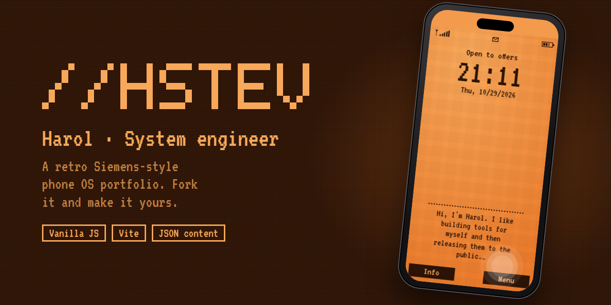

<p align="center">
  
</p>

<p align="center">
  <a href="https://hstev.github.io"><b>Live demo → hstev.github.io</b></a>
</p>

# //hstev portfolio

My portfolio, built as the operating system of an old Siemens phone: orange LCD backlight, the VT323 pixel font, soft keys and a scrolling menu. It is mobile-first, has no framework (vanilla JS + Vite), and **all the content lives in JSON files**, so you can make it yours without touching the code.

## Features

- **Boot screen** where your pixel-art logo lights up as the loading bar.
- **Home screen** with clock, date and a typewriter greeting.
- **Navigable menu** with arrow keys, number shortcuts, swipe gestures and the two soft keys.
- **Status bar that means something:**
  - **Signal:** whether you are looking for a job. Tap it to see your location in pixel art.
  - **Battery:** your availability (on vacation, busy, partial, side projects, open to offers).
  - **Envelope:** your email, with a copy button.
- **Backlight** that dims after 25 s without use, like the real thing.
- Respects `prefers-reduced-motion`, works with keyboard only, and labels everything for screen readers.

## Use it as a template

Like the style? **Fork it** and make it your own portfolio:

1. **Fork** this repository. Name it `<your-user>.github.io` to publish it at the root of your GitHub Pages, or keep any other name to publish it at `<your-user>.github.io/<repo>` (the base path is handled automatically).
2. Edit the files in [`src/data/`](src/data) with your own information (see below).
3. In your fork, go to **Settings → Pages → Source** and choose **GitHub Actions**.
4. Forks have Actions disabled by default: open the **Actions** tab and enable workflows.
5. Push to `main`. The [deploy workflow](.github/workflows/deploy.yml) builds the site and publishes it.

If you build something with it, I'd love to see it. Open an issue and share the link!

## Getting started

Requires **Node 24** (see [`.nvmrc`](.nvmrc)).

```bash
nvm use
npm install
npm run dev      # local development server
npm run build    # production build in dist/
npm run preview  # serve the production build
```

## Editing the content

All the text is in [`src/data/`](src/data):

| File | What it holds |
|---|---|
| `site.json` | Name, logo, role, home greeting, email, location, signal (`openToWork`), battery (`availability`) and the menu |
| `availability.json` | Battery states: `vacation`, `busy`, `partial`, `side`, `offer` |
| `about.json` | The paragraphs of *About me* |
| `education.json` | Degrees and certifications |
| `experience.json` | Jobs. Dates are `"YYYY-MM"`; leave out `"to"` for your current job and the duration is calculated for you |
| `projects.json` | Name, link and description of each project |
| `skills.json` | The skill tags |

The logo is drawn with a 5×7 pixel font. If your logo uses a letter that isn't there yet, add it to [`src/ui/pixel-font.js`](src/ui/pixel-font.js).

The location pop-up shows pixel art of Medellín. Replace [`src/art/medellin.js`](src/art/medellin.js) with your own city.

### Adding a page to the menu

1. Create `src/data/<page>.json` and `src/pages/<page>.js`, a function that returns the HTML for the page body.
2. Register it in [`src/pages/index.js`](src/pages/index.js).
3. Add `{ "title": "...", "page": "<page>" }` to the `menu` in `site.json`.

A menu entry with no registered page shows an "under construction" pop-up, so you can add it to the menu before it's done.

## Project structure

```
index.html            markup only
src/
  data/               content (JSON)
  pages/              one module per menu page + registry
  ui/                 status bar, boot/logo, home, pop-ups, toast, backlight
  styles/             CSS split by component
  app.js              navigation state and rendering
  input.js            keyboard, touch and click bindings
  content.js          access to the site-wide data
  lib/                DOM helpers, HTML escaping, dates
  art/                pixel art
```

## Deployment

- **GitHub Pages:** [`.github/workflows/deploy.yml`](.github/workflows/deploy.yml) builds with Node 24 and deploys on every push to `main`.
- **Vercel:** import the repository and it works as is ([`vercel.json`](vercel.json) sets the build command and the `dist/` output).

The banner above is generated from [`.github/assets/banner.html`](.github/assets/banner.html), which also explains how to regenerate it.

## Contributing

Contributions are welcome: bug fixes, accessibility improvements, new pixel-font glyphs, new page types… Read [CONTRIBUTING.md](CONTRIBUTING.md) before opening a pull request.

## License

[MIT](LICENSE) © Harol Restrepo. Fork it, change it and use it for your own portfolio.
